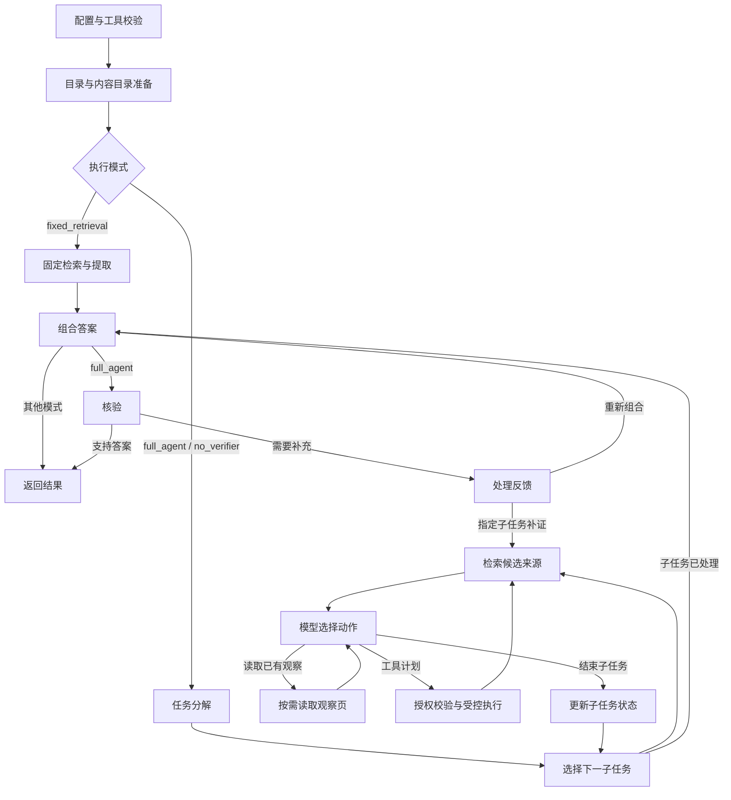

# LangGraph流程与安全执行边界

适用于0.7.0。运行流程使用LangGraph `StateGraph`；`run`、`resume`、共享模型和队友端口仍按核心契约v0.5工作。模型通过原有异步`httpx`适配器调用API，不需要改成LangChain模型客户端。

## 实际执行流程

`workflow.py`将执行阶段拆成独立图节点，而不是把整个`run()`放进一个节点：

节点路由和临时状态属于单次运行；每次调用构造绑定独立控制器的图。图节点顺序执行，工具节点内部继续使用原来有界的安全并行调度。子任务依赖失败、观察分页、无效计划、证据不足和预算停止仍沿用原语义。

## 三层职责

| 层 | 负责内容 |
|---|---|
| LangGraph流程 | 节点、条件分支、子任务循环与核验反馈 |
| 现有控制器 | 工具白名单、参数和来源授权、依赖、预算、超时、重试、并发准入、证据身份与审计提交 |
| SQLite调用日志 | 调用意图、已验证响应、原请求/期限、单run租约与安全恢复 |

节点不能跳过控制器直接执行适配器。图层不另外配置自动重试、缓存、超时或持久化checkpointer；这些额外机制可能让同一次外部调用被重新执行或产生两套相互矛盾的恢复状态。

## 恢复与取消

`resume`从图起点重建流程，但历史调用只返回已保存且校验过的响应。重建完成后才允许新调用；结果未知的外部操作仍拒绝自动恢复。原预算与绝对期限不会重置，恢复目录时的真实本地重新注册仍计入调用数。详见[持久恢复说明](durable-recovery.md)。

运行时版本、源码摘要和图引擎依赖版本共同参与兼容性检查。0.6.x未终结运行不能用0.7.0继续；可以保留旧记录用于查看。当前不支持跨版本状态迁移。

图执行拥有独立任务。调用方取消时，控制器先取消图任务并等待其节点退出，之后才关闭审计文件、释放租约并向调用方传播取消；重复取消不会反复打断图的退出过程。适配器仍需合作式取消：永久阻塞或永不退出的适配器不能由asyncio强制终止。

图步数上限依据子任务、反馈轮数、工具步骤和观察读取上限推导，不使用LangGraph默认25步，也不只看模型请求数。本地规划返回`Usage.local()`时不会消耗provider额度，因此不能把模型额度当作唯一循环次数上限。真实预算和停止码仍由控制器决定。

本地流程不自动启用外部LangSmith追踪，也不继承调用方的追踪回调或内建run collector。审计仍写入本地JSONL和artifact；图执行结束后恢复调用方原有上下文。

若旧环境设置了已废弃的`LANGCHAIN_TRACING`或`LANGCHAIN_HANDLER`，运行前需执行`unset LANGCHAIN_TRACING LANGCHAIN_HANDLER`；当前LangChain-Core会拒绝这些旧全局配置。本运行时不会修改进程环境变量；现代V2追踪上下文在图内局部隔离。

## 接入与实际收益

队友继续实现[ports.py](../src/lake_agent/ports.py)中的异步协议，通过[工作台注册说明](project-workspace.md#同学如何接入模块)绑定模块；无需了解图内部状态或修改对外请求。

迁移的收益是让执行分支和循环更清楚、便于扩展流程及独立检查节点。工具并行、证据校验与安全恢复本来已经存在，本次将流程迁移到图引擎，不能因此宣称模型更聪明或响应更快。真实数据和内容模块接入后，仍需固定任务集进行质量、费用与延迟测量。

代码入口：[workflow.py](../src/lake_agent/workflow.py)、[运行控制器](../src/lake_agent/runtime.py)、[恢复协调](../src/lake_agent/recovery.py)。测试与安装证据见[当前验收记录](project-workspace-acceptance-2026-11-02.md)。
