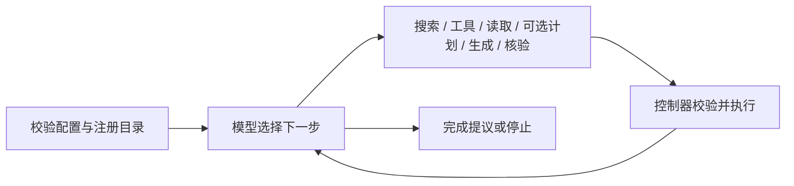

# LangGraph 流程与安全执行边界

运行流程使用 LangGraph `StateGraph`；`run`、`resume` 和队友 DataPort/ContentPort 继续使用核心异步接口。模型通过异步 `httpx` 适配器调用 API，无需改成 LangChain 模型客户端。

## 唯一模型驱动图

公开入口是 `runtime.py` 的 `run/resume`。`engine/graph_runner.py` 负责共享图编译、追踪隔离、取消传播和收尾，承接原 `workflow.py` 中仍在使用的执行机制；`engine/agent_workflow.py` 承载唯一的动作图。规划器必须声明 `agent-loop-v1` 并实现 `AgentPlannerPort.decide`。旧子任务图、decompose/select_tools 接口及自动回退已经删除，不存在两套图叠加执行。

图提供动作路由，不强制分解、搜索、工具或核验顺序。每轮经过 planner.decide 调用；max_agent_turns 为本地零用量循环设置独立上限。finish 是模型的完成提议，由控制器按当前运行政策接纳。日常 require_verification 默认 false，允许未核验完成；设为 true 时，必须有适用于当前完整答案与证据的 supported 核验，提前结束的策略冲突以拒绝观察返回模型。full_agent 名称本身不启用该政策；completed、内部核验通过、外部评测正确是三个不同概念。

复杂任务的模型提示鼓励先用可选 DAG 计划组织工作记忆，随发现修改计划和 completed_subtask_ids。结构未知时先确认目录、可信 inspect/schema 工具或观察分页，再决定过滤和聚合。核验失败时根据 issues/recommendation 选择定向补证、修改答案或停止，避免重复失败参数；这些提示是启发，不是图的强制顺序。

目录元数据通过既有 prepare_catalog 交给 C；无正文证据也可请求目录说明或澄清，引用仍不能伪造。动态工作上下文有总字节上限，分页前预留未解决反馈的结构化身份，紧随读取的决策收到完整页面，其他字段使用明确的省略或截断预览；后续动作产生新反馈时，较旧页面可明确标记省略。临时状态属于单次运行，各次运行绑定独立控制器；图节点串行执行，工具节点内部按可信声明受控并行。

## 内容输出错误与下一轮决策

内容端口显式声明 `content-feedback-v1` 后，已知的 `invalid_model_citations`、`invalid_model_sources`、`invalid_model_output` 进入反馈观察：控制器拒绝该答案或核验输出，记录 `content.output.rejected`，再由 decide 选择修正、补证、读取或停止。控制器也检查 status=ok 的输出引用，成功封套不能绕过引用授权。没有声明的旧内容端口继续接收基础请求；HTTP/鉴权/超时/提供方封装或端口契约错误保持终止，不借该通路重发。

规划器通过已有 context 看到具体错误；内容模型是独立调用，同阶段再次 compose/verify 时才收到含 `ContentFeedback` 的扩展请求。内容适配器把动态反馈放进 provider `messages[].content`，不新增 HTTP 顶层参数、不改原 question、不伪造 evidence。每个调用仍最多一次请求，不在节点或适配器内部自动重试。完整协议、诊断和示例见[内容反馈说明](content-feedback.md)。

拒绝输出不覆盖已有有效答案或核验；同阶段成功后清除反馈，新答案变化使旧核验失效。存在未解决反馈时 finish 返回 `unresolved_content_failure` 拒绝观察，不报告 completed。Full 强制核验和 no_verifier 的门禁继续生效。每轮决策、实际模型调用和耗时均计入原预算，反复失败最终按统一上限停止。

## 核验新鲜度与答案修订

合法核验结果绑定其实际检查的完整问题、完整答案、完整证据列表与运行政策的确定性指纹。模型上下文里的预览不参与验收比较；新时间、恢复 attempt 或审计顺序也不参与。生成不同答案会清除当前核验收据，新答案状态为 missing；答案相同但证据变化时，保留的历史收据为 stale，表示不再适用，不能当作新的不支持判定。未改变验收相关状态的工具或计划操作不会无条件触发额外核验；完整输入未变时，重复生成同一答案也不能清除失败判定。

context.verification_status 显式区分 missing/current/stale；历史核验仍可预览，但只有 current 的 verification_verdict 可作当前判定。`finish` 按下表处理；表中核验分支以已有接纳答案且没有未解决内容反馈为前提。

| 当前状态 | `require_verification=false` | `require_verification=true` |
|---|---|---|
| 存在未解决内容反馈 | `unresolved_content_failure`，返回决策 | 同左 |
| 无已接纳答案 | `answer_required`，返回决策 | `answer_required`，返回决策 |
| `missing` | 接受完成 | `verification_required`，返回决策 |
| `stale` | 接受完成，旧结论不作为当前判定 | `verification_stale`，返回决策 |
| `current` 且 `supported` | 接受完成 | 接受完成 |
| `current` 且其他合法 verdict | 以 `insufficient_evidence / agent_verification_failed` 停止 | `verification_required`，返回决策 |

控制器先检查未解决反馈，再检查是否有答案，最后应用核验政策。合法的不支持核验不会在 verify 节点直接终止，模型仍有机会补证或修改答案；只有模型之后提出 finish，才进入以上政策分支。通过 supported 核验也不会自动触发 finish。

compose 可通过 revision_instructions 指定1–4000字符的修改目标。已有答案时，控制器构造 ComposeRequest.revision，带完整 previous_answer、相关 verification、verification_is_current 和 instructions；没有旧答案却指定目标会以 revision_answer_required 拒绝。无状态 C 据此修改答案，不依赖隐式会话。首次 compose 的 revision 默认为空且序列化省略。修订数据进入提供方 messages，不改 question、不充当 Evidence、不提升权限或刷新预算。外部真实内容实现必须升级共享模型并实际传给自己的模型，仓库不声称已修改队友模块。

## 交互与实验策略

| 场景 | 运行方式 | 核验策略 |
|---|---|---|
| 日常交互 | full_agent 自主动作图 | require_verification=false，模型可选择核验 |
| Proposal 完整组 | full_agent 自主动作图 | require_verification=true，必须有当前有效的 supported 核验 |
| Proposal 无核验组 | no_verifier 自主动作图 | require_verification=false，verify 动作被拒绝 |
| Proposal 固定检索组 | tests/support/ablation.py 中的本地固定策略复用控制器 | 固定 top-k 后一次生成，不调用模型规划器与核验 |

固定检索不属于应用的执行 mode；评估报告层仍支持三组比较。no_verifier 与 require_verification=true 在外部调用前以 invalid_run_policy 停止。max_feedback_rounds 和 fixed_extract_max_chars 已从 RunConfig 删除，核验后的继续调查受统一轮数及调用预算约束。

## 三层职责

| 层 | 负责内容 |
|---|---|
| LangGraph 流程 | 下一动作路由、临时工作记忆、完成与停止 |
| 运行控制器 | 工具声明、参数和来源授权、依赖、预算、超时、重试、并发准入、证据身份与审计提交 |
| SQLite 调用日志 | 调用意图、已验证响应、原请求与期限、单次运行租约与恢复 |

节点不能跳过控制器直接执行适配器。图层不额外配置自动重试、缓存、超时或持久化 checkpointer，避免重复外部调用和两套恢复状态。核验建议作为模型观察返回，不自动重访最初的子任务。

## 恢复与取消

`resume` 从图起点重建流程，历史调用只返回已保存且校验过的响应。重建完成后才允许新调用；结果未知的外部操作拒绝自动恢复。原预算与绝对期限不重置，内容目录的本地重新注册仍计入调用数。详见[持久恢复说明](durable-recovery.md)。

内容反馈由 SQLite 中的已知失败响应重建，修正请求也完整持久化并严格匹配；核验指纹和 revision 同样从完整已保存输入确定性重建，不要求新内容实例保留旧聊天历史。恢复前检查内容反馈能力是否改变，变化以 recovery_contract_mismatch 拒绝；修正调用结果未知也以 recovery_outcome_unknown 拒绝，不能自动重复已付费请求。

运行时版本、源码摘要和图引擎依赖版本共同参与兼容性检查。源码摘要包含根目录公共模块以及 `engine/`、`adapters/` 中的 Python 文件，并按包内相对路径区分文件；目录迁移也会改变源码摘要，旧版本未终结运行不能直接继续。历史记录仍可保留查看，当前不支持跨版本状态迁移。

图执行拥有独立任务。调用方取消时，控制器先取消图任务并等待节点退出，再关闭审计文件、释放租约并向调用方传播取消；重复取消不会反复打断退出过程。适配器仍需合作式取消：永久阻塞或永不退出的适配器不能由 asyncio 强制终止。

图步数上限按 max_agent_turns 推导，不使用 LangGraph 默认 25 步。本地规划返回 Usage.local() 不消耗提供方额度，但仍消耗一轮决策，因此模型请求额度不能作为唯一循环上限。真实预算和停止码仍由控制器决定。

本地图执行不继承外层 LangSmith 追踪、回调或内建 run collector。审计写入本地 JSONL 和 artifact；图退出后恢复调用方上下文。如果环境设置了已废弃的 LANGCHAIN_TRACING 或 LANGCHAIN_HANDLER，应由宿主清除；运行时不修改进程环境。

## 代码阅读与接入

| 文件 | 阅读内容 |
|---|---|
| [ports.py](../src/lake_agent/ports.py) / [models.py](../src/lake_agent/models.py) | 队友端口、动作请求与运行配置 |
| [engine/agent_workflow.py](../src/lake_agent/engine/agent_workflow.py) | 动作节点与模型循环 |
| [engine/agent_context.py](../src/lake_agent/engine/agent_context.py) | 有界上下文与目录分页 |
| [engine/content_feedback.py](../src/lake_agent/engine/content_feedback.py) | 具体输出诊断与显式内容修正能力 |
| [engine/graph_runner.py](../src/lake_agent/engine/graph_runner.py) | 图执行、取消和追踪隔离 |
| [runtime.py](../src/lake_agent/runtime.py) / [engine/tool_runtime.py](../src/lake_agent/engine/tool_runtime.py) | 授权、预算与受控工具调度 |
| [engine/recovery.py](../src/lake_agent/engine/recovery.py) | 已知响应重放与恢复准入 |
| [adapters/planner.py](../src/lake_agent/adapters/planner.py) | 真实模型调用、策略提示与动作解析 |

`engine/` 是正式运行的内部实现；外部接入仍使用 `runtime.py`、`models.py` 与 `ports.py`。实验运行器在 `tests/`，报告格式在独立的 `evaluation/models.py`。全部文件映射见[源码目录说明](source-layout.md)。

队友继续实现异步 DataPort/ContentPort，通过[工作台注册说明](project-workspace.md#编程注册)绑定模块，无需依赖图内部状态。工具并行、证据校验与恢复属于执行能力；真实数据和内容模块接入后，仍需用固定任务集测量答案质量、费用与延迟。历史[验收记录](project-workspace-acceptance-2026-11-02.md)仅代表归档版本。
